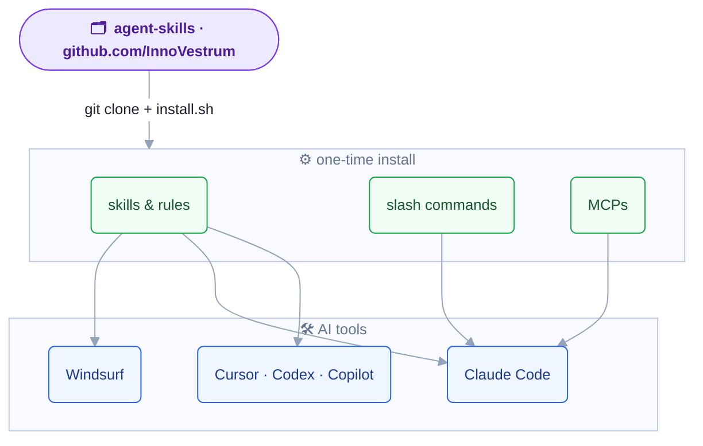

# InnoVestrum Agent Skills

Portable [Agent Skills](https://agentskills.io) and global engineering rules for InnoVestrum — shared across every AI coding tool you use.

## Architecture



## Compatibility

| Feature | Windsurf | Claude Code | Codex CLI | Cursor | Copilot |
|---|:---:|:---:|:---:|:---:|:---:|
| Global rules (`AGENTS.md`) | ✅ | ✅ | ✅ | ✅ | ✅ |
| Skills (`~/.agents/skills/`) | ✅ | ✅ | ✅ | ✅ | ✅ |
| MCP servers (context7, brave-search) | 🔧 | ✅ | 🔧 | 🔧 | ➖ |
| GitHub (native OAuth) | ➖ | ✅ | ➖ | ➖ | ➖ |

> 🔧 = guided setup via `setup-mcps` skill

## Installation

### macOS / Linux / Git Bash

```bash
git clone https://github.com/InnoVestrum/agent-skills.git ~/.agents/agent-skills
bash ~/.agents/agent-skills/install.sh
```

### Windows (PowerShell)

```powershell
git clone https://github.com/InnoVestrum/agent-skills.git $HOME\.agents\agent-skills
powershell -ExecutionPolicy Bypass -File $HOME\.agents\agent-skills\install.ps1
```

> Requires **Developer Mode** (Settings → Privacy & security → For developers) *or* an elevated PowerShell — Windows blocks symlink creation otherwise. Both installers pre-flight this and abort with instructions if it's missing.

**What the installer does:** symlinks skills, global rules, and slash commands; creates the canonical repo symlink. If the Claude Code plugin marketplace clone (`~/.claude/plugins/marketplaces/innovestrum/`) is present, it also runs `git pull --ff-only` there so newly-pushed skills become visible to the plugin without a separate manual update. It does **not** install the Claude Code plugin — that step is still manual (see below).

To update:

```bash
# bash
git -C ~/.agents/agent-skills pull && bash ~/.agents/agent-skills/install.sh
```
```powershell
# PowerShell
git -C $HOME\.agents\agent-skills pull; & $HOME\.agents\agent-skills\install.ps1
```

### Claude Code plugin (manual)

Open Claude Code and run:

```
/plugin marketplace add InnoVestrum/agent-skills
/plugin install innovestrum-standards@innovestrum
```

You'll be prompted for a GitHub Personal Access Token (`repo`, `read:org` from [github.com/settings/tokens](https://github.com/settings/tokens)). This interactive flow is the only supported path — the `claude plugin install` shell command cannot pass `userConfig` values, which leaves the GitHub MCP unconfigured and silently dropped.

### MCP setup for other tools

After install, ask your agent *"set up MCPs"* — it will invoke the `setup-mcps` skill.

## Skills

| Skill | Description |
|---|---|
| [`manage-rules`](skills/manage-rules) | Add, edit, or delete global engineering rules in `AGENTS.md` |
| [`manage-skills`](skills/manage-skills) | Add, edit, or delete skills in this repository |
| [`manage-commands`](skills/manage-commands) | Add, edit, or delete Claude Code slash commands |
| [`manage-mcps`](skills/manage-mcps) | Add, edit, or remove MCP server declarations |
| [`setup-mcps`](skills/setup-mcps) | Guided MCP setup for Windsurf, Cursor, Codex, and Claude Code |
| [`research-an-idea`](skills/research-an-idea) | Desk-research pipeline for an idea or market: brief → parallel cited tracks → red team → synthesis; findings only, the owner decides |

## Skill Format

Each skill follows the [agentskills.io spec](https://agentskills.io/specification) — YAML frontmatter + Markdown body in `skills/<name>/SKILL.md`. The agent loads only `name` and `description` at startup (progressive disclosure), reading the full file only when the skill is relevant.

See [CONTRIBUTING.md](./CONTRIBUTING.md) to add or improve skills.

## License

[MIT](./LICENSE)
